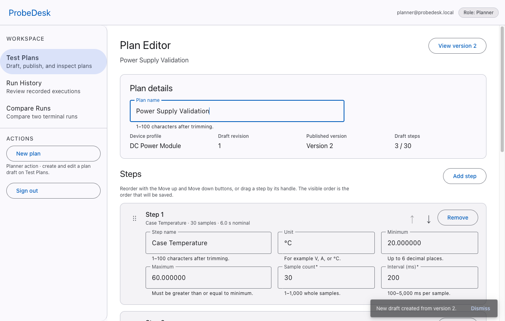
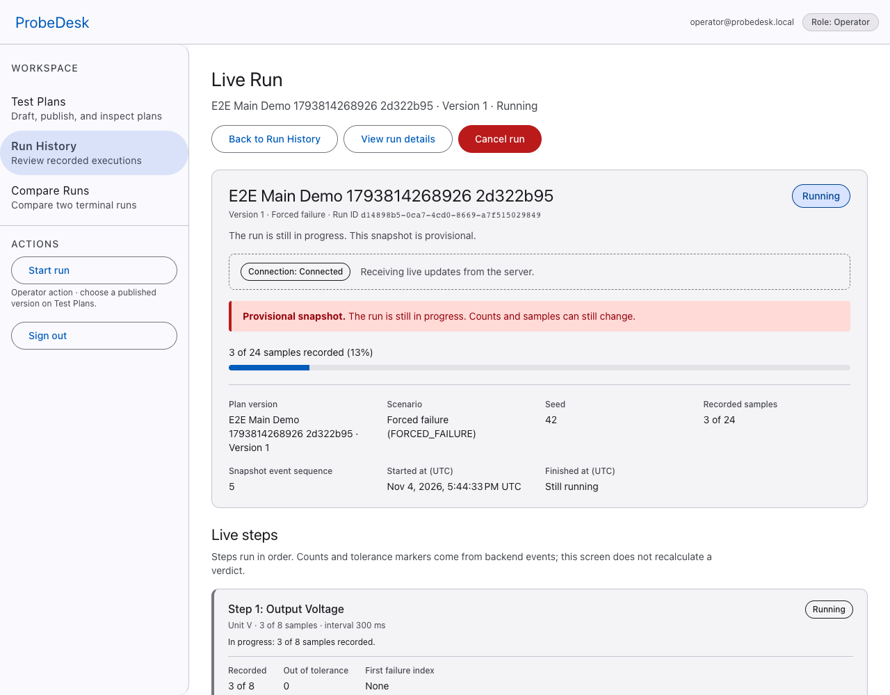
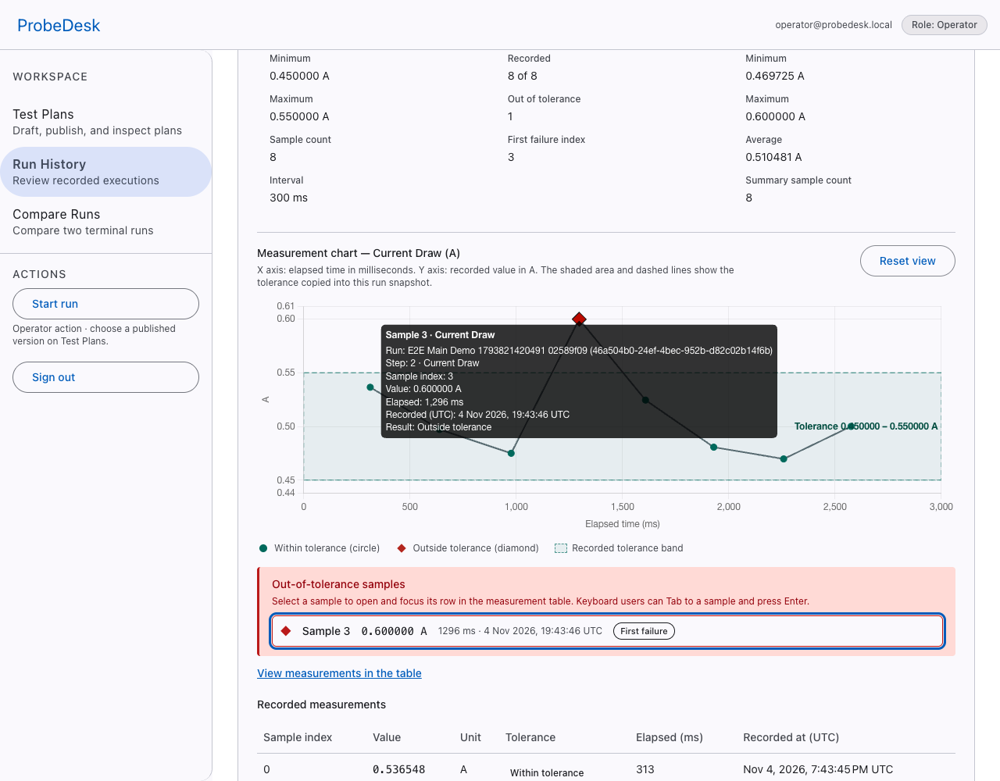
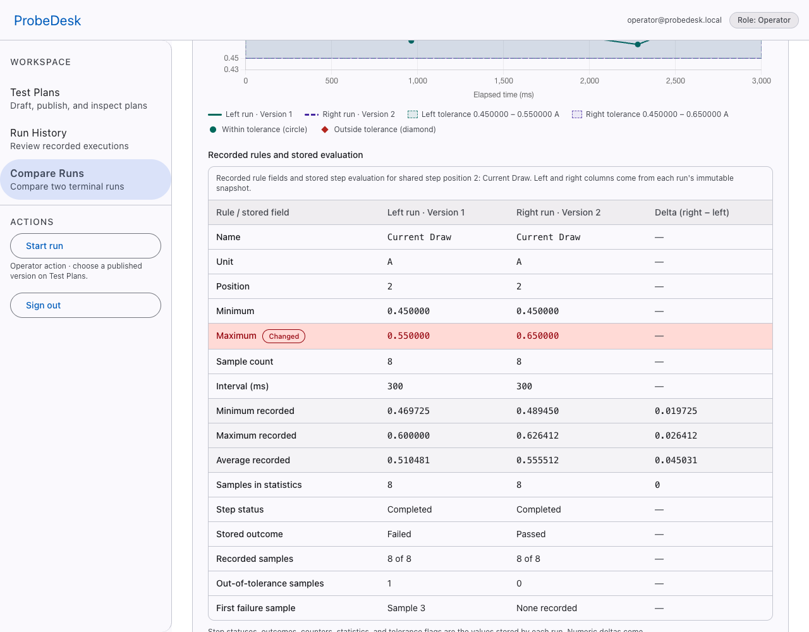

# ProbeDesk

ProbeDesk is a full-stack application for creating versioned measurement plans for electronic
devices, running them against a deterministic software simulator, investigating every
measurement against its published tolerances, and comparing recorded runs.

The repository contains a working local delivery: NestJS API, Angular UI, PostgreSQL, seeded
demo history, automated tests, and a Docker Compose stack served through an nginx same-origin
proxy at `http://127.0.0.1:8080`.

**Current status (2026-11-04):** phases 1–7 and delivery tasks P8-01–P8-04 are technically
accepted. The P8-06 release candidate is in review; P8-05 (demo video) was waived by the user.
The final product acceptance belongs to the user and has not been recorded. The application is a
localhost demo, not a hosted production service.

## What it does

- **Plan authoring** — Planner creates three-step measurement plans, reorders steps by mouse or
  keyboard, saves drafts with optimistic concurrency, and publishes immutable versions.
- **Deterministic execution** — Operator starts `NORMAL`, `FORCED_FAILURE`, or `RANDOM` runs with
  a fixed seed. One API process enforces one active run at a time.
- **Backend verdicts** — tolerance evaluation, step outcomes, counters, and run snapshots are
  calculated by the API; the Angular UI never recalculates a verdict.
- **Live progress** — Server-Sent Events stream recorded measurements to the Live Run screen with
  replay, cursor deduplication, reconnect, and gap reconciliation.
- **Investigation** — Run History, Run Details, tolerance bands, failure markers, chart
  tooltips, zoom/pan/reset, and an accessible measurement table.
- **Comparison** — two terminal runs of the same plan are compared by version, rules, stored
  outcomes, statistics, units, and sampling; old runs keep the rules captured in their snapshot.
- **Roles** — Planner, Operator, and Viewer permissions are enforced by the API, not only by the
  UI.

## Screenshots

All images below were captured from the running Angular application during recorded verification
runs. Links point to the evidence records with the commands and observed results.

| Plan editor | Live execution |
|---|---|
|  |  |
| **Failure investigation** | **Run comparison** |
|  |  |

The failure and comparison screenshots come from the P7 main demo
([evidence](docs/evidence/phase-7-e2e.md)); the editor screenshot comes from the Phase 2 plan
lifecycle evidence ([evidence](docs/evidence/phase-2-demo.md)).


## Quick start

### A. Development with Docker PostgreSQL and npm

Prerequisites: Node.js `22.23.2` (`.nvmrc`), npm `11.6.2` (pinned in `packageManager`), and
Docker. Ports `4200`, `3000`, and `5432` must be free.

```bash
npx npm@11.6.2 ci
cp .env.example .env
docker compose up -d
# wait until `docker compose ps -a` reports postgres healthy
npm run db:migrate
npm run demo:seed
npm run dev
```

`docker compose up -d` starts only PostgreSQL; the next commands apply migrations and seed the
demo, and `npm run dev` starts the applications. Open `http://localhost:4200`. The root `dev`
script starts the NestJS API in watch mode on `http://127.0.0.1:3000` and the Angular dev server on
`http://localhost:4200`; the Angular proxy forwards `/api` to the API.

If port `5432` is already used, set `PROBEDESK_DEV_DB_PORT` for Compose **and** change the port
inside `DATABASE_URL` in `.env` (for example to `5434`) before starting either service. The
documented demo data is additive: `npm run demo:seed` never resets an existing plan, run, or
account.

### B. Full delivery with Docker Compose

No host Node.js or PostgreSQL is required for this path.

```bash
docker compose --profile delivery up -d --build
```

Open `http://127.0.0.1:8080`. The stack starts PostgreSQL, applies migrations, runs the
idempotent demo seed, starts one API process, and serves the built Angular app and `/api` proxy
through nginx. `docker compose --profile delivery ps -a` should show `migrate` and `seed` exited
with code 0, and `api`/`web` healthy.

Useful overrides:

- `PROBEDESK_DELIVERY_PORT` changes the published web port from `8080`.
- `PROBEDESK_DEV_DB_PORT` changes the host PostgreSQL port from `5432`; delivery containers always
  use the internal port.
- `docker compose down` keeps the named volume. `docker compose down -v` deletes the local demo
  database and is intentionally not part of any normal start, seed, or verification command.

Both entry points share the `probedesk-postgres-data` volume, so the delivery demo shows the same
local plans and runs as the development workflow.

## Demo accounts

These passwords are local demo fixtures only. The seed refuses to run with
`NODE_ENV=production` and never changes an existing account's password or role.

| Role | Email | Password |
|---|---|---|
| Planner | `planner@probedesk.local` | `PlannerDemo!2026` |
| Operator | `operator@probedesk.local` | `OperatorDemo!2026` |
| Viewer | `viewer@probedesk.local` | `ViewerDemo!2026` |

## Main demo flow

The seeded fixture contains one `DC Power Module` profile, the `Power Supply Validation` plan in
published versions 1 and 2, and four recorded runs: a partial cancelled run, a forced failure, a
normal v1 pass, and a normal v2 pass. See [docs/demo.md](docs/demo.md) for the full script and
[docs/evidence/phase-8-seed.md](docs/evidence/phase-8-seed.md) for the generated data. If a local
development database already contains older plans with the same name, the seed preserves them; use
a clean delivery database for the exact fixture.

1. Sign in as Planner and open **Test Plans** → **Power Supply Validation**. Version 2 is the
   latest published version; version 1 remains available as an immutable snapshot.
2. Inspect v1: three steps, 30 samples each at 200 ms, 90 expected samples in total.
3. Sign in as Operator, open v1, choose **Start run**, scenario **FORCED_FAILURE**, seed `42`, and
   failing step **Current Draw**.
4. Watch **Live Run** finish as `FAILED`. Current Draw records `0.600000 A` at sample index `14`
   (the 15th sample) against a published maximum of `0.550000 A`; the third step still runs.
5. Open **Run Details** and select the first failure. The chart marks the out-of-tolerance sample
   and the measurement table shows the same `0.600000 A` value.
6. Open **Run History**, select the forced-failure v1 run and the normal v1 run, then **Compare**.
   The runs share version 1; outcomes are `Failed` and `Passed`, with one violation versus none.
7. Compare the v1 failure with the normal v2 run. The comparison reports different versions and
   one changed rule: Current Draw maximum `0.550000 → 0.650000`. The old v1 run still stores and
   displays `0.550000`.
8. Open the partial cancelled run: 45 of 90 samples were recorded; step states are
   `Completed`, `Cancelled`, and `Not run`.
9. Restart with `docker compose --profile delivery down` followed by
   `docker compose --profile delivery up -d`; plans and runs remain because the named volume is
   preserved ([persistence evidence](docs/evidence/phase-8-clean-install.md)).

## Architecture and stack

```text
Browser (Angular)
  ├─ REST requests ─┐
  └─ EventSource ───┤
                    ▼
          nginx same-origin proxy
             ├─ Angular assets
             └─ /api → NestJS API
                          ├─ auth / sessions / roles
                          ├─ plans / immutable versions
                          ├─ runs / executor / evaluator
                          ├─ deterministic simulator
                          ├─ persistent events / SSE replay
                          └─ comparisons
                                │
                                ▼
                            PostgreSQL 18
```

| Area | Implementation |
|---|---|
| Backend | Node.js `22.23.2`, TypeScript `6.0.3`, NestJS `12.3.2`, Prisma `7.10.1`, PostgreSQL `18.1` |
| Frontend | Angular `22.2.4` standalone components, Angular Material/CDK, typed Reactive Forms, RxJS, Chart.js `4.6.1` |
| API contract | OpenAPI document plus generated client types in `packages/api-client` |
| Auth | Argon2id passwords, opaque server-side sessions, HttpOnly cookies, CSRF protection, role guards |
| Delivery | Docker Compose, nginx reverse proxy, named PostgreSQL volume, one API process |
| Verification | Vitest (API unit, Angular, API integration), Playwright with real Chrome, GitHub Actions |

More detail: [architecture](docs/architecture.md), [data model](docs/data-model.md), and
[API contract](docs/api.md). Product requirements and the acceptance checklist are in
[requirements](docs/requirements.md) and [acceptance](docs/acceptance.md).

## Quality checks

The current verification run on 2026-11-04 produced: API unit `16` files / `118` tests, web
`36` files / `370` tests, successful API and web production builds, and a current OpenAPI contract
and generated client.

```bash
npm run verify                 # lint, typecheck, API unit, web tests, builds, OpenAPI check
```

Integration tests use the isolated PostgreSQL container from `compose.test.yaml` on
`127.0.0.1:5433`:

```bash
docker compose -f compose.test.yaml up -d
npm run db:migrate:test --workspace apps/api
npm run test:api:integration   # 22 files / 197 tests in the recorded run
```

Playwright runs the main demo and comparison scenarios against the real Angular app, API,
PostgreSQL, and executor. It requires the dedicated E2E database and the API/web startup described
in [`tests/e2e/README.md`](tests/e2e/README.md):

```bash
npm run test:e2e               # 2 scenarios in the recorded run
```

Recorded evidence:

- [Full `verify` and integration output](docs/evidence/phase-8-docs.md)
- [Main demo E2E](docs/evidence/phase-7-e2e.md), [CI pipeline](docs/evidence/phase-7-ci.md)
- [Clean compose install and persistence](docs/evidence/phase-8-clean-install.md)

### CI

[`.github/workflows/ci.yml`](.github/workflows/ci.yml) runs six jobs on pushes to `main` and pull
requests: API quality, API integration against PostgreSQL 18, web quality, OpenAPI contract,
Playwright E2E, and a required aggregate check. The recorded run for commit `3d27f2f` passed all
six jobs ([run 41885922086](https://github.com/kemalselcuk/probedesk/actions/runs/41885922086),
[evidence](docs/evidence/phase-7-ci.md#gerçek-github-actions-koşusu-2026-11-04)). Failure
artifacts are retained for 7 days; no repository secrets or paid services are used.

## Project structure

```text
apps/api                 NestJS API, Prisma schema/migrations, simulator, seed, tests
apps/web                 Angular application and component tests
packages/api-client      Generated OpenAPI client types
tests/e2e                Playwright demo and comparison scenarios
infra/nginx              Same-origin static/proxy configuration
docs/                    Product contract, task cards, plans, and verification evidence
compose.yaml             PostgreSQL development service + full delivery profile
compose.test.yaml        Standalone isolated integration-test database
```

## Known limitations

- **Single API process.** The simulator and executor run inside one API process; there is no
  horizontal scaling or high-availability mode. After an API/process restart, in-flight runs are
  reconciled to `INTERRUPTED` and are not resumed; a retry is a new run.
- **Localhost only.** The documented delivery is HTTP on `127.0.0.1` with
  `SESSION_COOKIE_SECURE=false`. TLS termination, secure cookies, a public domain, and production
  operations are out of scope.
- **Narrow demo scope.** One device profile, one seeded plan, three roles, one active run, and no
  registration, password reset, or user administration.
- **Chrome-verified UI.** Browser verification used real Chrome/Chromium. Safari, Firefox, and
  physical mobile devices were not verified; responsive checks covered 1280 px and 768 px
  layouts only.
- **Acceptance is still open.** Phases 1–7 and P8-01–P8-04 are technically accepted. The P8-06
  release candidate is in review, the demo video (P8-05) was waived by the user, and final user
  acceptance has not been recorded.
- **Evidence is commit-scoped.** The release candidate `v0.1.0-rc.1` is commit `270a399`; its
  six-job CI run is [41900767940](https://github.com/kemselcuk/probedesk/actions/runs/41900767940)
  (all green). Documentation-only follow-ups keep their own commit history.
- **No coverage or performance claims.** Test counts and durations are reproduced from real
  reports; no coverage percentage, benchmark, or capacity figure is claimed.
- **Zero additional infrastructure cost.** All delivered tooling is local/open source and CI uses
  the free standard runner; no paid service is enabled.

## Documentation

- [Implementation guide](docs/implementation-guide.md) — current status, reading order, working
  agreement.
- [Documentation index](docs/README.md) — all product and technical documents.
- [Demo script](docs/demo.md) — seeded fixtures and the exact UI flow.
- [Testing contract](docs/testing.md) — test matrix, verified commands, CI reality.
- [Final acceptance checklist](docs/acceptance.md) — still awaiting user acceptance.
- [Evidence index](docs/evidence/README.md) — real screenshots, test output, CI, delivery records.

The application and user-facing messages are in English. The implementation and planning
documents are in Turkish; identifiers and protocol names remain English.
